 

Venho de marketing digital e gestão de times e hoje lidero tecnologia com foco em Inteligência Artificial. Entendo o problema do negócio na ponta (funil, CRM, mídia, atendimento) e construo a plataforma que o resolve, do pipeline de dados à interface, com IA entrando onde ela gera resultado.

 

## Trajetória

 

## Plataformas que construí

Os repositórios são privados porque contêm dados de operação. Aqui está a arquitetura de cada um.

 

### Nexus: assistente pessoal de IA com voz, memória e ação

Assistente em português no estilo JARVIS. Eu falo "Nexus" (ou aceno para a webcam), peço o que preciso e ele responde em voz alta. Cuida de agenda, e-mail, WhatsApp, tarefas, gastos, reuniões e do próprio computador, e aprende meus hábitos com o uso.

<b>O que ele faz</b>

 

| Área | Capacidades |
|:--|:--|
| **Conversa e memória** | pesquisa na web, notas e recuperação por contexto |
| **Agenda e e-mail** | várias contas Google, leitura de não lidos, rascunho de resposta no meu jeito de escrever |
| **WhatsApp** | resumo de conversas, quem está me esperando, mensagens e áudios com a voz do Nexus |
| **Ritmo do dia** | plano da manhã com tarefas encaixadas na agenda, aviso antes de reunião, fechamento do dia e revisão da semana |
| **Reuniões** | grava microfone e som da chamada, transcreve e gera ata com decisões e tarefas |
| **Gastos** | lê e-mails e notificações de compra e monta o relatório do mês |
| **Missões** | pesquisa em segundo plano com relatório e delegação de tarefas |
| **Controle do PC** | apps, janelas, terminal, tela e área de transferência, por uma extensão GNOME própria |
| **Modo sombra** | webcam 100% local: aceno para acordar, gestos de mídia, postura e presença |
| **Monitor do servidor** | temperatura, CPU, memória e disco com alertas em voz e no WhatsApp |

<b>Decisões de engenharia que valem destaque</b>

 

- **Roteador de LLMs com fila auto-ordenada:** a ordem dos modelos se ajusta sozinha por taxa de acerto e velocidade medidas nos últimos 7 dias. Modelo que falha ou esgota a cota vai para o fim da fila.
- **Camada paga com teto de orçamento:** até 90% do teto tudo usa o modelo pago, de 90% a 100% só tarefas pesadas, e no teto só modelos gratuitos, com alertas em 80% e 100%.
- **Segurança por padrão:** token em toda rota de dados, serviço exposto só em rede privada, confirmação obrigatória em ações sensíveis e proteção contra instruções injetadas em conteúdo de terceiros (e-mail, site, mensagem, tela).
- **Privacidade:** imagens da webcam e da tela só saem do computador quando eu peço.

`Python` · `FastAPI` · `SQLite` · `Docker` · `Tailscale` · `LLMs` · `Evolution API` · `Qt` · `PWA`

 

### Capta IA: inteligência comercial e de marketing por cliente

Sistema que transforma o método de captação da agência em produto. Junta, por cliente, marketing (Meta e Google Ads), comercial (CRM) e qualidade do atendimento (conversas de WhatsApp avaliadas por IA). Responde perguntas como "o mês vai bater a meta?", "quais anúncios trazem cliente de verdade?" e "o que cada vendedor precisa corrigir?". Quem usa não é especialista em dados, então toda tela traz resumo em linguagem simples, glossário e cores de status.

<b>Módulos</b>

 

| Módulo | O que responde |
|:--|:--|
| **Estratégia** | cadastro e plano de cada instituição em 9 etapas, ciclos de meta e plano de captação em PDF |
| **IA Comercial** | resultado por fechamento e por safra, previsão do mês, vendas por origem e acompanhamento de cada vendedor contra o time |
| **IA Marketing** | do anúncio ao CRM até a venda, ranking de criativos, simulador de investimento e conversas que não viraram negociação |
| **AD Zap** | WhatsApp dos vendedores integrado ao CRM, com áudio transcrito e tempo de resposta |
| **Relatórios** | resumo mensal para enviar ao cliente e auditorias geradas por IA |
| **API de consulta** | leitura segura da estratégia de cada cliente para agentes de IA |

<b>Decisões de engenharia que valem destaque</b>

 

- **Regras de negócio testadas:** todo número que decide cor de status tem teste. Cálculo isolado da rota e do template, com mais de 110 testes que rodam sem rede.
- **Honestidade nos dados:** o painel detecta venda fora do padrão, venda sem valor e venda parada na etapa errada, e avisa em vez de esconder.
- **Evidência obrigatória na IA:** o perfil ideal do cliente só é confirmado quando o modelo cita o trecho da conversa que prova.
- **Desempenho:** aquecedor de cache carrega os dados de todos os clientes logo após a subida e renova em segundo plano, então nenhuma tela espera o BigQuery.
- **Deploy contínuo simples:** push na main vai ao ar em minutos, com reinício adiado enquanto há avaliação de IA em lote rodando.

`Python` · `FastAPI` · `Jinja2` · `SQLite` · `BigQuery` · `ECharts` · `Claude` · `Gemini` · `Cloudflare Tunnel`

 

### Portal: shell de aplicações internas com permissões

Plataforma que funciona como shell para um ecossistema de apps. Centraliza navegação, autenticação, identidade visual e catálogo, e cada app roda como módulo integrado, com contexto de sessão e permissões herdados.

- Dois contextos, agência e cliente, com biblioteca de apps liberada por perfil.
- Permissões por usuário, time ou empresa, validadas no backend.
- Contrato claro para novos apps: registro em catálogo, rotas padronizadas, tema sincronizado e checklist de go-live.
- Guia técnico próprio de arquitetura, segurança, observabilidade e versionamento.

`Python` · `FastAPI` · `Jinja2` · `Tailwind` · `SQLite` · `GitHub Actions`

 

### Pipeline de dados do atendimento

Automação que exporta diariamente os relatórios de leads de várias contas de clientes, sem navegador, e carrega tudo no BigQuery. Alimenta o Capta IA e roda sozinha em produção, agendada, sempre com a versão mais recente do código e credenciais fora do repositório.

`Python` · `BigQuery` · `Automação` · `Cron`

 

### Também no meu GitHub

Integrações com GA4 e API do ClickUp, fluxos de aprovação de peças criativas, calculadora de marketing, auditorias automatizadas, agente de tarefas com IA e ferramentas de publicação de conteúdo.

 

## O problema de negócio por trás de cada plataforma

| Problema na operação | Como resolvi |
|:--|:--|
| Dados de CRM, mídia e WhatsApp espalhados em ferramentas diferentes | Visão unificada por cliente, com cálculo testado e status em linguagem simples (Capta IA) |
| Avaliar atendimento de vendas exige ler conversa por conversa | Avaliação por IA em lote, com evidência citada da própria conversa |
| Rotina pessoal pulverizada entre agenda, e-mail, WhatsApp e tarefas | Assistente com voz e memória que cuida do dia e age no computador (Nexus) |
| Cada nova ferramenta interna reinventa login, permissão e visual | Shell único com catálogo de apps, perfis e contrato de integração (Portal) |
| Exportar relatórios de várias contas na mão, todo dia | Pipeline agendado que entrega os dados prontos no data warehouse |
| Custo de IA sem controle | Roteamento de modelos com fila gratuita, camada paga e teto mensal |

 

## Stack

  

| Área | Ferramentas |
|:--|:--|
| **IA** | LLMs (Claude, Gemini), agentes, roteamento de modelos, voz, avaliação com evidência, engenharia de prompt |
| **Dados** | BigQuery, pandas, SQLite, pipelines agendados, Power BI, ECharts |
| **Backend** | Python, FastAPI, Jinja2, testes com pytest |
| **Infraestrutura** | Linux, Docker, Proxmox, Cloudflare, Tailscale, GitHub Actions |
| **Marketing tech** | Meta Ads, Google Ads, RD Station, Tintim, atribuição e CRM |

 

## Como eu trabalho

- **Problema primeiro, tecnologia depois.** IA só entra quando resolve algo real.
- **Quem usa não é especialista.** O produto tem que se explicar sozinho.
- **Número que decide precisa de teste.** Dado sem confiança é só planilha bonita.
- **Segurança e custo desde o dia um.** Permissões, confirmações e tetos de gasto fazem parte do design.
- **Documentar faz parte de entregar.**

 

Cruz Alta, RS · Brasil
